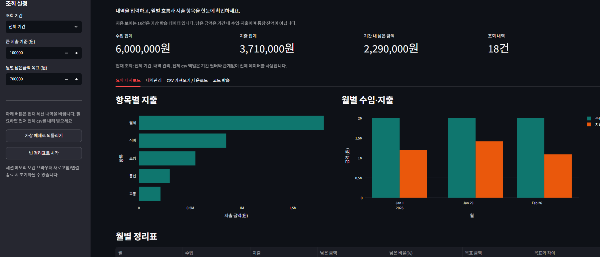

# 💰 나의 입출금 정리표

> 수입·지출 내역을 입력하면 월별 흐름과 항목별 지출을 한눈에 보여 주는 **Streamlit 가계부 웹 앱**

pandas로 연습한 데이터 처리 코드를 **재사용 가능한 모듈(`finance.py`)** 로 분리하고, 그 위에 **입력 · 검증 · 집계 · 시각화 · CSV 입출력**까지 갖춘 웹 화면(`app.py`)을 올린 개인 프로젝트입니다.


## 📸 화면



<!-- 내역관리 화면을 docs/screenshots/management.png 로 저장한 뒤 아래 주석을 해제하세요.

-->

---

## ✨ 주요 기능

| 탭 | 기능 |
|---|---|
| **사이드바** | 조회 기간(월) 선택, 큰 지출 기준 금액, 월별 남은 금액 목표, 예제/빈 표로 초기화 |
| **요약 대시보드** | KPI 카드 4개(수입·지출·남은 금액·건수), 항목별 지출 막대그래프, 월별 수입·지출 그래프, 목표 대비 월별 정리표, 큰 지출 목록 |
| **내역관리** | 새 내역 추가 폼, 엑셀처럼 직접 고치는 전체 내역 편집 표(행 추가·삭제), 중복 내역 경고, 구분·항목별 조회 필터 |
| **CSV 가져오기·다운로드** | CSV 업로드 → 검증 → 미리보기 → 추가/교체 반영, 전체 백업·조회 내역·요약 CSV 다운로드 |
| **코드 학습** | 수업에서 배운 pandas 코드와 앱 코드의 연결 설명 |

---

## 🏗 아키텍처


**화면과 데이터 처리를 파일로 분리했습니다.**

| 파일 | 역할 |
|---|---|
| `app.py` | Streamlit 화면 구성, 세션 상태 관리, 사용자 입력 흐름 제어 |
| `finance.py` | 검증(`validate_records`), 파생 열(`add_features`), 집계(`summarize`), CSV 읽기/쓰기 |

### 실행·저장 흐름


C4 모델(컨텍스트 → 컨테이너 → 컴포넌트) 기준의 자세한 설명은 [아키텍처 문서](docs/architecture.md)에 정리했습니다.

---

## 🔍 설계 포인트

### 1. 모든 데이터 변경은 하나의 관문을 거친다
내역 추가, 표 수정, CSV 반영, 초기화가 모두 `save_records()` → `validate_records()`를 지나갑니다.
**검증을 통과한 데이터만 저장**되므로, 어디서 입력하든 잘못된 데이터가 섞이지 않습니다.

```python
def save_records(frame, message):
    clean = validate_records(frame)      # 틀리면 ValueError → 저장 안 됨
    st.session_state.records = clean
    st.session_state.revision += 1       # 편집 표를 새 데이터로 다시 그리기 위한 버전 번호
    st.session_state.message = message
    st.rerun()
```

### 2. 사용자가 고칠 수 있는 오류 메시지
날짜 형식·구분·항목 길이·금액 범위를 **행 단위 마스크**로 한 번에 검사하고, 틀린 행 번호를 최대 10개까지 알려 줍니다.

```
[금액: 1원~1조원 양의 정수] 조건을 확인하세요. 잘못된 데이터 행: 3, 7
```

### 3. 원본과 조회용 데이터를 분리
기간 필터는 원본(`records`)을 건드리지 않고 파생 열을 붙인 복사본만 잘라서 씁니다.
그래서 **전체 CSV 백업은 어떤 기간을 보고 있든 항상 모든 내역**을 내려받습니다.

### 4. 실제 파일을 고려한 CSV 처리
- **인코딩**: UTF-8로 읽다가 실패하면 CP949(옛 한글 엑셀)로 다시 시도
- **크기 제한**: 5MB · 5,000행 초과 파일은 거절
- **엑셀 호환**: `utf-8-sig`(BOM)로 저장해 엑셀에서 한글이 깨지지 않음
- **CSV 인젝션 방지**: `=`, `+`, `-`, `@`로 시작하는 값 앞에 `'`를 붙여 엑셀이 수식으로 실행하지 않게 함

### 5. Streamlit의 재실행 구조에 맞춘 상태 관리
Streamlit은 버튼을 누를 때마다 스크립트 전체를 다시 실행합니다.
유지해야 할 값은 `st.session_state`에 두고, 안내 메시지와 필터 초기화 신호는 `pop()`으로 꺼내 **딱 한 번만** 적용되게 했습니다.

---

## 🚀 실행 방법

```bash
git clone https://github.com/hyeonn31/my-finance-system.git
cd my-finance-system
pip install -r requirements.txt
streamlit run app.py
```

브라우저에서 http://localhost:8501 이 열리고, 가상 예제 18건이 자동으로 로드됩니다.

> 데이터는 브라우저 세션에만 저장됩니다. 새로고침하면 초기화될 수 있으니 필요하면 **전체 CSV 백업**을 받아 두세요.

---

## 📁 폴더 구조

```
my-finance-system/
├── app.py                     # Streamlit 화면
├── finance.py                 # 데이터 처리 (검증 · 파생 열 · 집계 · CSV)
├── requirements.txt
├── data/
│   └── sample_transactions.csv    # 가상 예제 데이터 18건
└── docs/
    ├── architecture.md            # C4 아키텍처 문서
    ├── images/                    # 아키텍처 다이어그램
    ├── notebooks/                 # 앱을 만들기 전 pandas 분석·함수 연습 기록
    ├── 프로젝트_설명.pdf
    └── 아키텍처_및_데이터_흐름.pdf
```

---

## 📄 CSV 형식

| 날짜 | 구분 | 항목 | 금액 |
|---|---|---|---|
| 2026-01-01 | 수입 | 월급 | 2000000 |
| 2026-01-05 | 지출 | 월세 | 600000 |

| 컬럼 | 규칙 |
|---|---|
| 날짜 | `YYYY-MM-DD`, 실제 존재하는 날짜 (1900~2100년) |
| 구분 | `수입` 또는 `지출` |
| 항목 | 1~40글자 |
| 금액 | 1원 ~ 1조 원 사이의 양의 정수 |

이 외의 컬럼은 무시합니다.

---

## 🛤 개발 과정

1. **노트북에서 분석** — pandas로 수입/지출 분리, 항목별 합계, 월별 피벗 테이블 작성 ([노트북](docs/notebooks/01_입출금_데이터_분석.ipynb))
2. **함수로 정리** — 반복되는 처리를 검증·집계 함수로 묶고 테스트 ([노트북](docs/notebooks/02_finance_함수_연습.ipynb))
3. **모듈 분리** — 함수를 `finance.py`로 옮겨 화면 코드와 분리
4. **웹 앱 구현** — 사이드바·KPI → 대시보드 → 내역관리 → CSV 입출력 순으로 기능 추가
5. **문서화** — C4 모델로 아키텍처 정리

### 겪은 문제와 배운 점

| 문제 | 원인 | 배운 점 |
|---|---|---|
| 항목별 그래프에서 `ValueError` | 그래프는 `"지출합계"`, 집계 함수는 `"지출 합계"`로 열 이름이 달랐음 | 모듈 사이에서 주고받는 열 이름은 띄어쓰기까지 정확히 맞춰야 함 |
| 저장 후 필터가 초기화되지 않음 | 위젯 `key` 오타(`veiw_categories`) | `session_state`로 위젯을 제어할 때는 key 문자열이 곧 주소 |
| CSV "전체 교체"가 항상 "추가"로 동작 | 비교 문자열 앞에 공백(`" 전체 내역 교체"`) | 선택지 문자열은 한 곳에서 정의해 재사용하는 편이 안전 |
| 안 보이는 탭의 오류로 앱 전체가 멈춤 | Streamlit 탭은 선택 여부와 관계없이 모두 실행됨 | 탭 화면도 매 실행마다 전부 실행된다는 점을 고려해야 함 |
| 월별 그래프 x축에 `Jan 1, Jan 29…` 같은 엉뚱한 날짜 표시 | `"2026-01"` 문자열을 Plotly가 날짜로 자동 해석 | `fig.update_xaxes(type="category")`로 축 형식을 명시 |
| 저장해도 반영 안 된 것처럼 보임 | 완료 메시지가 페이지 맨 위에만 표시됨 | 스크롤 위치와 상관없이 보이는 `st.toast`로 피드백 보강 |

---

## 🔭 개선 계획

- [ ] 영구 저장소(SQLite) 연결로 새로고침 후에도 데이터 유지
- [ ] `finance.py` 단위 테스트(pytest) 추가
- [ ] Streamlit Community Cloud 배포
- [ ] 예산 대비 지출 알림, 카테고리 자동 분류
