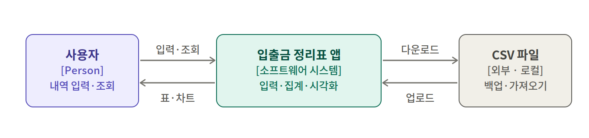
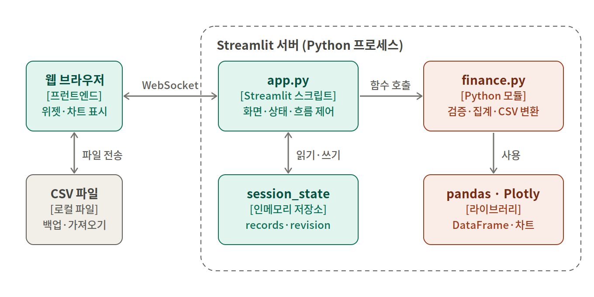
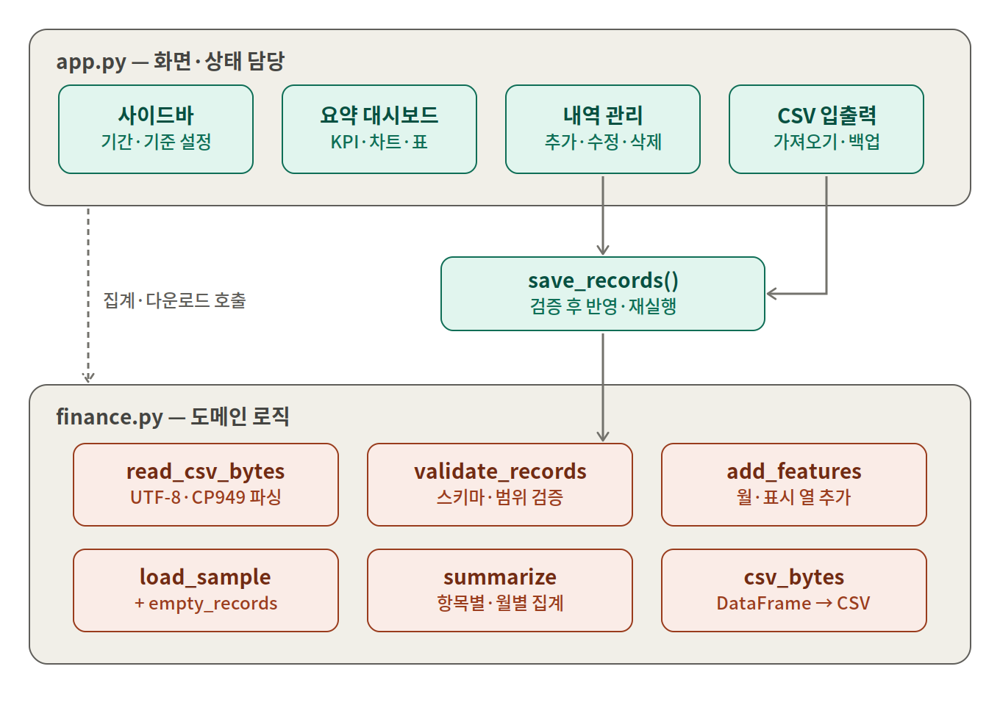
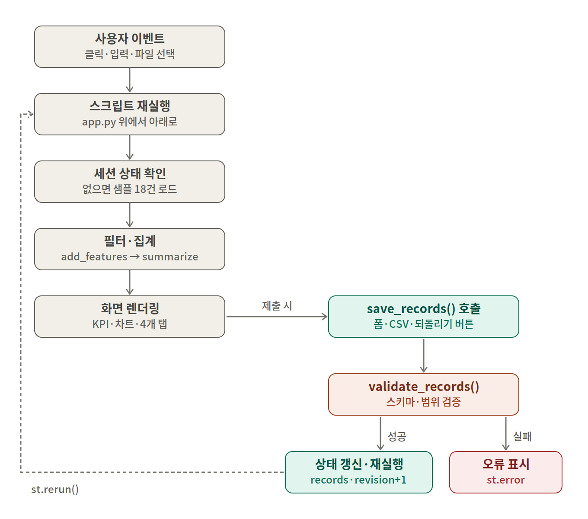

# 나의 입출금 정리표 — C4 아키텍처 문서

대상: `app.py` (Streamlit UI) + `finance.py` (도메인 로직)

---

## 1. 시스템 컨텍스트 (C4 Level 1)

| 요소 | 유형 | 설명 |
|---|---|---|
| 사용자 | Person | 입출금 내역을 입력하고 요약을 조회하는 학습자 |
| 입출금 정리표 앱 | 소프트웨어 시스템 | 내역 관리, 월별·항목별 집계, 시각화 제공 |
| CSV 파일 | 외부(로컬) | 사용자 PC의 파일. 업로드(가져오기)와 다운로드(백업)로만 연결 |

DB, 외부 API, 인증, 계좌 연동은 없습니다.

---

## 2. 컨테이너 (C4 Level 2)

| 컨테이너 | 기술 | 책임 |
|---|---|---|
| 웹 브라우저 | Streamlit 프런트엔드 | 위젯·Plotly 차트 렌더링, WebSocket으로 서버와 통신 |
| `app.py` | Streamlit 스크립트 | 화면 구성, 세션 상태 관리, 흐름 제어 |
| `finance.py` | Python 모듈 | 검증, 파생 열, 집계, CSV 변환 |
| `st.session_state` | 인메모리 | 사용자별 `records`, `revision` 등 보관 |
| pandas · Plotly | 라이브러리 | DataFrame 처리, 차트 생성 |

- 화면과 Python 계산은 모두 서버에서 실행됩니다.
- 영구 저장소가 없어 새로고침·연결 종료 시 데이터가 초기화될 수 있습니다. CSV 백업이 유일한 영속 수단입니다.
- 사용자 데이터를 전역 캐시에 넣지 않고 세션에만 보관합니다.

---

## 3. 컴포넌트 (C4 Level 3)

### app.py

| 컴포넌트 | 역할 |
|---|---|
| 사이드바 | 조회 기간, 큰 지출 기준, 월 목표 설정, 예제/빈 표 초기화 |
| 요약 대시보드 | KPI, 항목별 지출·월별 수입지출 차트, 월별 정리표, 큰 지출 목록 |
| 내역 관리 | 새 내역 추가 폼, 전체 수정·삭제 표, 조회용 필터 |
| CSV 입출력 | CSV 업로드·검증·반영, 다운로드 5종 |
| `save_records()` | 모든 데이터 변경의 단일 관문. 검증 후 세션 갱신·재실행 |

(코드 학습 탭은 정적 설명이라 생략)

### finance.py

| 함수 | 역할 |
|---|---|
| `read_csv_bytes` | CSV 바이트 파싱 (UTF-8/CP949, 크기·행 수 제한) |
| `validate_records` | 스키마·범위 검증 후 정제된 DataFrame 반환 |
| `add_features` | 월·표시 등 파생 열 추가 |
| `summarize` | 항목별 지출, 월별 수입·지출·남은금액 집계 |
| `csv_bytes` | DataFrame → CSV 바이트 |
| `load_sample` / `empty_records` | 가상 예제 18건 / 빈 표 생성 |

### 설계 포인트

1. **저장 게이트 단일화**: 내역 추가, 표 수정, CSV 반영, 초기화 모두 `save_records()` → `validate_records()`를 거칩니다. 검증을 통과한 데이터만 세션에 들어갑니다.
2. **중복 반영 방지**: 저장 성공 시 `revision`을 올려 편집 표 위젯 키를 바꿉니다.
3. **원본/파생 분리**: 기간 필터는 `add_features()` 결과를 자르는 방식이라 원본 `records`는 그대로입니다. 전체 CSV 백업이 기간과 무관한 이유입니다.

---

## 4. 실행·저장 흐름도

Streamlit은 위젯 조작마다 `app.py`를 처음부터 다시 실행합니다.

**기본 렌더링 (왼쪽)**

1. 사용자 이벤트 발생
2. 스크립트 재실행
3. 세션에 `records`가 없으면 샘플 18건 로드
4. `add_features` → 기간 필터 → `summarize`
5. KPI·차트·4개 탭 렌더링

**저장 분기 (오른쪽)**

1. 폼 제출·CSV 반영·되돌리기 버튼이 `save_records()` 호출
2. `validate_records()` 검증
3. 성공: `records` 갱신, `revision`+1, 필터 초기화, `st.rerun()`으로 1단계부터 재실행
4. 실패: `ValueError`를 잡아 `st.error`로 표시 (상태 변경 없음)
